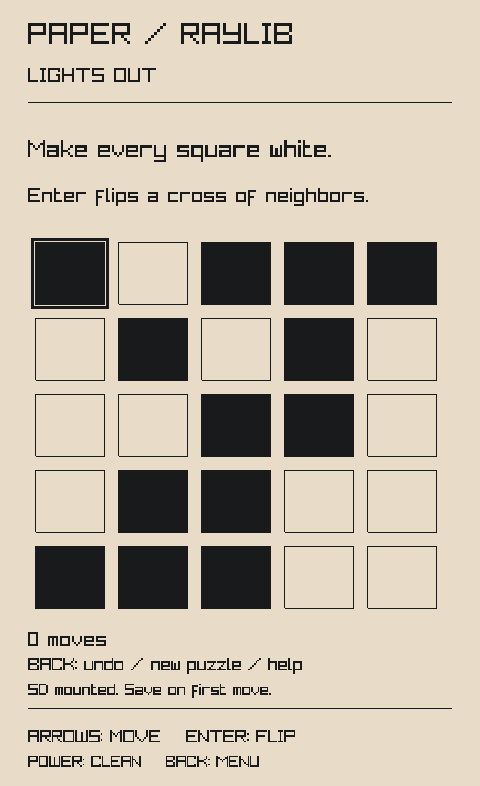
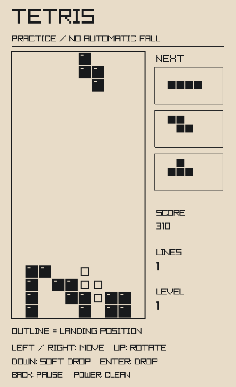

# raylib for Xteink X4

Build 2D applications for the **original ESP32-C3 Xteink X4** with raylib. Draw at the panel's native 480 × 800 resolution, run the same application in a desktop emulator, and deploy it with ESP-IDF.

[Documentation](docs/README.md) · [Hardware setup](docs/hardware.md) · [Contributing](CONTRIBUTING.md) · [Changelog](CHANGELOG.md)

<p>
  
  
</p>

*Paper and Tetris running in the microreader desktop emulator.*

- **Familiar raylib APIs:** shapes, text, textures, alpha blending, 2D cameras, input, and files.
- **Fits the X4:** four grayscale levels, dithered to monochrome, with 192 KB of pixel buffers and no PSRAM requirement.
- **Built for e-paper:** changed-region updates, optional asynchronous presentation, and factory waveforms.
- **Two playable examples:** Paper, a Lights Out puzzle with persistent saves and undo; and Tetris, with Normal and Practice modes.

## Quickstart

Build Paper firmware with Docker:

```sh
docker build --output type=local,dest=build-docker/paper .
```

This exports flashable files and checksums using a pinned ESP-IDF toolchain. See [Docker builds](docs/docker.md) for Tetris, custom apps, and headless tests. No local SDK or Nix installation is required.

Follow the [hardware guide](docs/hardware.md) to back up and flash from your host. **Installation replaces the device firmware and partition table.** This target supports the original, unlocked ESP32-C3 X4; X3, X4 Pro, and locked variants are unsupported.

On the tested reader, ordinary cursor/menu updates complete in about **0.44 seconds**, and full cleans take about **3.8 seconds**. Paper and Tetris process ordinary controls during refreshes and clean on startup/wake or Power. See [performance measurements](docs/performance.md) for scope and limits.

## Desktop emulator

<details>
<summary>Quickstart with CMake (Linux)</summary>

On Linux, install the [build dependencies](docs/emulator.md#build) (CMake, a C/C++ compiler, Python, Git, and SDL2), then run from the project root:

```sh
python3 scripts/fetch-emulator.py
cmake -S . -B build -DCMAKE_BUILD_TYPE=Release
cmake --build build --parallel
./build/x4_demo
```

</details>

<details>
<summary>Quickstart with Nix (x86_64 Linux)</summary>

Nix supplies the pinned build dependencies. Run from the project root:

```sh
nix develop path:.
python3 scripts/fetch-emulator.py
cmake -S . -B build -DCMAKE_BUILD_TYPE=Release
cmake --build build --parallel
./build/x4_demo
```

</details>

Run `./build/x4_tetris` for Tetris. Use the arrow keys, Enter to confirm, Escape to go back, and `P` to clean the display. See [example controls](docs/examples.md) for each game.

The [emulator guide](docs/emulator.md) covers dependency installation, optional Nix setup, virtual SD storage, and screenshots.

## Write an application

Start with [examples/minimal.c](examples/minimal.c): include `raylib.h`, open a 480 × 800 window, and use the usual drawing loop. The [application guide](docs/application.md) covers custom builds, input, storage, memory limits, and the X4 refresh API.

This is a 2D target for e-paper interfaces and games. Audio, 3D, shaders, and render textures are outside its scope.

## Documentation

| Guide | Contents |
|---|---|
| [Emulator](docs/emulator.md) | Build, run, virtual SD, screenshots |
| [Docker](docs/docker.md) | Firmware builds, caching, headless tests |
| [Hardware](docs/hardware.md) | Back up, flash, switch applications, restore |
| [Application development](docs/application.md) | Build integration, API, input, memory |
| [Examples](docs/examples.md) | Paper and Tetris controls, saves, game rules |
| [Testing](docs/testing.md) | Native, sanitizer, QEMU, and device checks |
| [Design](docs/design.md) | Renderer, memory layout, display driver |

The target has been exercised in microreader, ESP32-C3 QEMU, and on a physical X4. [Validation results](docs/validation.md) distinguish automated checks from physical and optical observations.

## License

The target and firmware integration use the [zlib license](LICENSE). The desktop emulator adapter is **GPL-2.0-only**; it is not linked into the device firmware. Vendored code retains its upstream licenses. See [third-party notices](THIRD_PARTY.md).
