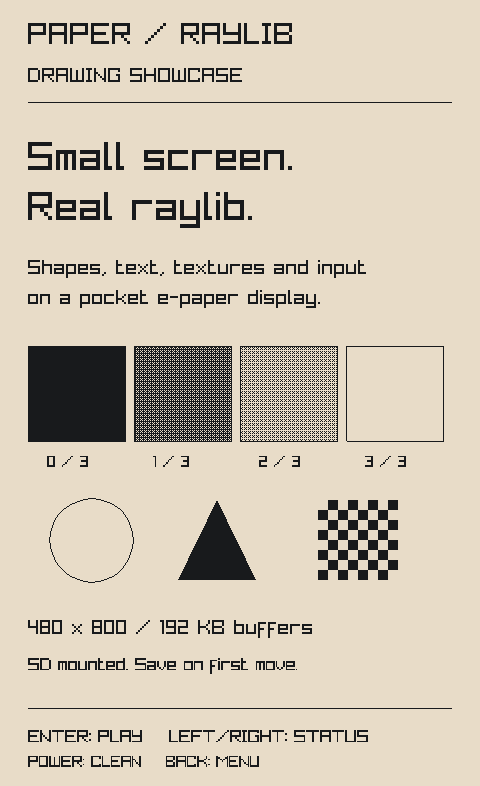

# raylib for Xteink X4

A native **480 × 800, 2D raylib target for the original ESP32-C3 Xteink X4**, with ESP-IDF firmware and the existing microreader desktop emulator. It uses upstream raylib 6.5-dev drawing, text, texture, camera, file, and input APIs. The packed software framebuffer fits in internal SRAM; no GPU or PSRAM is required.



Includes **Paper**, a drawing showcase and playable Lights Out puzzle with SD-card persistence. Enter opens the puzzle; arrows move around its grid and Enter flips a square and its orthogonal neighbors. Back opens a menu with undo, restart, new puzzle, help, device status, and sleep. Restart and new puzzle ask for confirmation. Power (`P` in the emulator) cleans the display and returns to the current screen. Sleep leaves a wake instruction on the panel; Power wakes the device and resumes a saved game.

Paper saves the board, cursor, starting puzzle, move count, and last 64 undo moves in `raylib-x4/paper-a.sav` and `paper-b.sav` on the SD card. Alternating, versioned, checksummed records preserve the previous save if a write is incomplete. A valid old `paper.txt` is imported without changing it; unrelated files are preserved. Save failures and no-card play are shown directly below the puzzle. Without storage, progress lasts only until the application exits.

The 1.1.1 performance fix reduces measured physical cursor updates from 2.45 seconds to about 0.73 seconds, and menu selection updates from 2.08 seconds to about 0.73 seconds. Rapid taps keep their order. Paper redraws only changed selections and waits for three seconds of idle time before its periodic cleaning refresh (after at least 12 partial updates). Power still requests a clean immediately. The current panel waveform takes about 0.7 seconds for a partial update and 3.8 seconds for a full clean; this remains an e-paper interface. See [physical performance measurements](docs/performance.md).

## Run the emulator

On NixOS, from this directory:

```sh
python3 scripts/fetch-emulator.py
nix develop path:.
cmake -S . -B build -G Ninja -DCMAKE_BUILD_TYPE=Release
cmake --build build -j
./build/x4_demo
ctest --test-dir build --output-on-failure
```

The explicit `path:.` also works in a directory without Git metadata. The flake locks the native tools, ESP-IDF 5.5.2, RISC-V toolchain, and Espressif QEMU. On other Linux systems, CMake ≥3.20, a C99/C++17 compiler, Python 3, and SDL2 ≥2.0.22 development files suffice for the native build.

The emulator compiles microreader's real `DesktopEmulatorDisplay` and `DesktopRuntime`, including its panel crop, rotation, paper palette, and refresh delays. The adapter provides raylib input and filesystem access. It is a native firmware simulator, not a CPU emulator. `X4_SD_ROOT` selects the virtual SD directory (default `./sdcard`). Set `X4_SD_ROOT=''` to emulate no card. An unavailable root also runs without storage; an existing read-only directory lets you test save-failure feedback.

```sh
python3 scripts/capture.py artifacts/demo.png 0   # page 0, 1, or 2
```

## Build and flash the device

```sh
nix develop path:.#firmware
idf.py -C firmware build
idf.py -C firmware size
```

The build produces `firmware/build/raylib_x4_firmware.bin` and the bootloader and partition table. A packaged image and checksums are in `dist/` after running `python3 scripts/package.py`. The optional `--hardware-tested` flag requires a passing physical QA report whose application SHA-256 matches the current binary; older evidence cannot attest a new build.

**This replaces the device firmware and partition table.** Use an original, unlocked ESP32-C3 X4; X3, X4 Pro, and newer locked variants are not this target. Back up the full flash before installing. With the appropriate serial port substituted:

```sh
python -m esptool --chip esp32c3 --port /dev/ttyACM0 read_flash 0 0x1000000 x4-backup.bin
python -m esptool --chip esp32c3 --port /dev/ttyACM0 verify_flash 0 x4-backup.bin
idf.py -C firmware -p /dev/ttyACM0 flash monitor
```

Alternatively, the packaged merged image is flashed at address **0**:

```sh
python -m esptool --chip esp32c3 --port /dev/ttyACM0 write_flash 0 dist/raylib-x4.bin
```

Never flash the application-only `.bin` at address 0; its address is `0x10000`. To restore a full backup, use `python -m esptool --chip esp32c3 --port /dev/ttyACM0 write_flash 0 x4-backup.bin`. The firmware mounts an existing FAT SD card at `/sd` and never formats it. Without a card, the example runs without persistence.

If Linux serial access is denied, an administrator can grant temporary access to this reader with `sudo bash scripts/grant-x4-access.sh SERIAL USER`, substituting its serial from `/dev/serial/by-id/` and your username. This targets one Espressif USB device and expires at reboot.

The firmware is tested in the microreader emulator, ESP32-C3 QEMU, and on an original physical X4 with a FAT microSD card. See [validation](docs/validation.md) for measured results and limits, and the [independent user QA report](docs/qa-user-report.md) for reproduced issues and retesting. The hardware diagnostic application and USB acceptance runner are included so another board can be tested reproducibly.

## Use it in an application

Start with [examples/minimal.c](examples/minimal.c). Include `raylib.h` and optionally `raylib_x4.h`, and use `InitWindow(480, 800, title)`. Other window dimensions are rejected. The portrait framebuffer covers the controller's entire panel; keep content at least 14 pixels from the top and bottom to allow for the bezel.

Build the same application for the emulator by selecting its entry point:

```sh
cmake -S . -B build-my-app -G Ninja \
  -DX4_APP_SOURCE="$PWD/examples/minimal.c"
cmake --build build-my-app -j
./build-my-app/x4_demo
```

For multiple source files, pass `-DX4_APP_EXTRA_SOURCES="/path/helpers.c;/path/model.c"` to either build. Only the entry point's `main` is renamed for firmware. An external CMake project can instead use:

```cmake
cmake_minimum_required(VERSION 3.20)
project(my_x4_app C CXX)
set(BUILD_TESTING OFF CACHE BOOL "" FORCE)
add_subdirectory(/absolute/path/to/raylib-x4 x4)
add_executable(my_x4_app application.c)
target_link_libraries(my_x4_app PRIVATE raylib::x4 x4_emulator)
```

To build a different C application for hardware:

```sh
nix develop path:.#firmware
idf.py -C firmware -B "$PWD/build-my-app-firmware" \
  -DX4_APP_SOURCE=/absolute/path/to/application.c build
```

The application supplies `int main(void)`. The firmware wrapper invokes it on the FreeRTOS main task and sleeps when it returns zero; a nonzero exit keeps USB available for recovery. Keep raylib calls on that task. Use a low target frame rate, or redraw only when state changes and call `PollInputEvents()` and `WaitTime()` while idle. `EndDrawing()` compares the output frame and skips unchanged display updates.

| Physical input | raylib key | Emulator key |
|---|---|---|
| Back | `KEY_ESCAPE` | Escape / Backspace |
| Confirm | `KEY_ENTER` | Enter |
| Left / Right | `KEY_LEFT` / `KEY_RIGHT` | Left / Right |
| Side Up / Down | `KEY_UP` / `KEY_DOWN` | Up / Down |
| Power | `KEY_P` | P |

Buttons are debounced and sampled every 5 ms on hardware. Presses are latched across blocking display refreshes. Use `GetKeyPressed()` in a loop when input order or repeated taps matter: up to 64 press edges survive a blocking refresh. `IsKeyPressed()` remains a per-frame boolean. `X4GetStatus().dropped_input_presses` reports queue overflow. Keys held longer than 450 ms become eligible for `IsKeyPressedRepeat()` every 150 ms; at most one repeat is delivered per poll, so blocking refreshes reduce the observed rate. A resistor ladder cannot distinguish every simultaneous button combination.

| X4 extension | Purpose |
|---|---|
| `X4RefreshFull()` | Force the next frame to clean the panel |
| `X4SetRefreshInterval(n)` | Clean after `n` partial updates; default 12, zero always cleans |
| `X4GetStats()` | Refresh/error/buffer counters and conversion/presentation timings |
| `X4GetStatus()` | Calibrated battery voltage, raw button ADCs, button mask, heap, and SD status |
| `X4GetPanelFrame()` | Read-only last presented 48 KB panel buffer; 1 means white |
| `X4GetStoragePath()` | `/sd`, the emulator SD directory, or `NULL` |

Use `X4GetStoragePath()` when forming asset/save paths. Working-directory-relative paths are not automatically mapped to SD. Limit textures and decoded images to fit the remaining heap. Loading a full-screen RGBA image requires 1.5 MB and is unsuitable for this MCU.

The default font's atlas and glyph images live in flash. The software renderer samples the atlas directly, and `ImageText()` remains supported. Treat the glyph images returned by `GetFontDefault()` as read-only; use `ImageCopy()` before modifying them. Updating the default font texture makes a RAM copy. Texture uploads return an invalid texture when memory or texture handles run out; check `IsTextureValid()`. `X4GetStatus().largest_block` helps size allocations, which must be contiguous.

Supported: 2D shapes, default bitmap text, bitmap fonts, small textures, alpha blending, camera transforms, scissor clipping, raymath, keyboard edges/repeat, timing, and SD files. Colors are quantized to four luminance levels during rendering and spatially dithered to monochrome during presentation. Image support includes PNG, BMP, TGA, and QOI; TTF, JPEG, and animated GIF are disabled in this profile.

Out of scope for this constrained target: 3D/depth, audio, render textures, programmable shaders, multitouch, mouse/gamepads, window management, wireless services, and OTA. This is an e-paper target for interfaces and turn-based games; its refresh latency is not suitable for conventional real-time action games. The hardware display calls block until the waveform completes, with a 15-second BUSY timeout.

## Verification

```sh
# Native suite, including actual emulator pixel readback and save/reload
ctest --test-dir build --output-on-failure

# AddressSanitizer + UndefinedBehaviorSanitizer for the target and SSD1677 protocol
cmake -S . -B build-test -G Ninja -DX4_SANITIZE=ON \
  -DX4_BUILD_EMULATOR=OFF -DCMAKE_BUILD_TYPE=Debug
cmake --build build-test -j
ctest --test-dir build-test --output-on-failure

# Real RISC-V / ESP-IDF execution with physical I/O replaced by a test HAL
nix develop path:.#firmware -c idf.py -C firmware -B build-qemu \
  -DX4_QEMU_SMOKE=ON -DSDKCONFIG="$PWD/build-qemu/sdkconfig" build
nix develop path:.#qemu -c python3 scripts/test-qemu.py
```

QEMU smoke images are test-only and must not be installed on the device. [Design and research](docs/design.md) describe the memory budget, upstream changes, controller protocol, and alternatives considered.

To run the USB hardware acceptance app after backing up the device:

```sh
nix develop path:.#firmware
idf.py -C firmware -B build-hardware \
  -DX4_APP_SOURCE="$PWD/examples/diagnostics.c" \
  -DSDKCONFIG="$PWD/build-hardware/sdkconfig" build flash
python scripts/test-device.py --port /dev/ttyACM0
python scripts/device.py status --capture artifacts/device-frame.png
```

The runner checks pixel checksums, SD writes and PNG asset loading, texture allocation failure, unchanged frames, cleaning policy, repeated refreshes, and close/reopen. Its PNG captures are framebuffer readbacks, not photographs. The diagnostic app also accepts `scene 0` through `scene 5`, `step`, `redraw`, `full`, `interval N`, `sdtest`, `assets`, `texturetest`, `oom`, `reopen`, `reboot`, `sleep`, and `sleep3` (three-second timer wake). `--listen 60` records physical button events; `python scripts/test-sleep.py` checks three timed sleep cycles. `--raw --listen 60` monitors ordinary firmware without sending diagnostic commands. Rebuild and flash the default app to return to Paper.

## Source and licensing

The target and firmware integration use the zlib license; raylib retains its upstream zlib license. The emulator executable links GPL-2.0 microreader code, so that executable and its adapter are GPL-2.0. It is not linked into the hardware firmware. See [THIRD_PARTY.md](THIRD_PARTY.md).

Upstream raylib is vendored at a fixed revision with a small [patch](patches/raylib-x4.patch). The emulator is fetched at a fixed revision. No upstream checkout is silently updated during a build.
